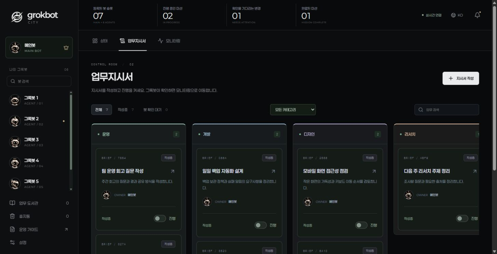
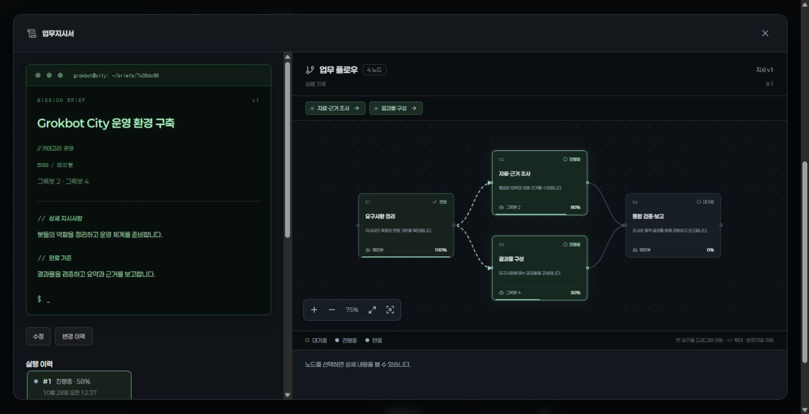
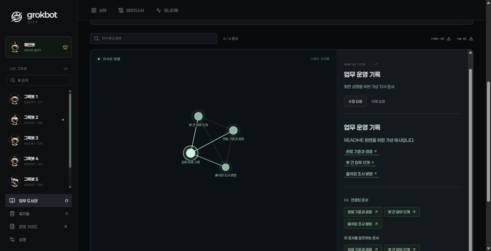

# Grokbot City

English · [한국어](README.ko.md)

A local dashboard for your bot team. Write task briefs, see which step each bot is working on, and keep the results in a shared knowledge library.

You use the dashboard to give instructions. Your main bot reads them and reports back through the CLI. The app itself does not connect to Grok or run a language model; the bot needs access to the computer where you install it.

## Write a brief, then send it to work



*Actual app screenshots with fictional examples, shown in Korean. A fresh installation starts without sample tasks or wiki pages.*

Keep unfinished briefs on category boards. Click a category name to rename it or change its color. Assign one bot to an individual task, or choose a Boss and up to five members for a team task.

Saving a brief keeps it here. Turn on **dispatch** when it is ready; once the main bot accepts it, the task moves to **Monitoring**.

## See where the work stands



Monitoring groups tasks into **Waiting**, **In progress**, and **Completed**. Open a task to read its brief on the left and follow the bot's workflow on the right. Nodes show the assigned bot, status, and progress, so you can see which step is underway.

Bots report when they start work, change steps, and finish. Their updates appear without a page refresh. Routine tasks retain a history of each run; the bot starts the next run when appropriate.

## Keep what the team learns



Archive completed tasks in the **Task library**, together with Markdown reports explaining the methods, trial and error, and results. The main bot turns these source materials into linked wiki articles. Open **Wiki MAP** to explore those connections and read a page beside the graph.

Restoring an archived task sends it back to **Task briefs**. Its wiki knowledge stays in place even if the original task is restored or deleted. Ask the main bot to revise or remove wiki content separately.

## Manage the bots behind the work

Select a bot in the sidebar to view its instructions and main responsibilities. After you edit instructions, the dashboard shows that they are waiting for the bot to acknowledge them, then records when they were applied.

- Start with one main bot and six empty agent profiles. The main bot can add more with `bot.create`.
- Set each bot's Codex, Claude Code, and other CLI preferences, or apply the main bot's settings to the team. These preferences guide the bots; they do not install or launch tools.
- Switch the interface between Korean and English. The dark interface uses bundled Paperlogy fonts and supports reduced motion.

## Run it locally

Install **Node.js 24 or newer**, then run:

```sh
git clone https://github.com/sleeplesshan/grokbot-city.git
cd grokbot-city
npm ci
npm run build
npm start
```

Open **http://127.0.0.1:4318**. If you downloaded a ZIP, extract it and open a terminal in that folder, starting with `npm ci`.

First launch creates the database, machine configuration, and local bot credential under `data/`. These files stay on your computer and are excluded from Git. There is no built-in demo mode.

### Give your main bot its first instructions

1. Open **Operating guide** in the sidebar.
2. Enter the installation computer and the project's absolute folder path.
3. Copy the startup prompt and give it to your main bot, which must be able to read files and run the CLI on that computer.

The prompt tells the bot which documents to read, how to register real bot names and photos, and how to bring ongoing work into Monitoring. You can also copy it from the [operating guide](docs/OPERATING_GUIDE.md).

Keep `data/bot.key` private. Put real profile images in the Git-ignored `public/assets/local/` folder and rebuild after adding them.

## Further reading

| When you need to… | Read |
| --- | --- |
| Use the dashboard and onboard your main bot | [Operating guide](docs/OPERATING_GUIDE.md) |
| Run in the background, back up, or set up private remote access | [Maintenance](docs/MAINTENANCE.md) |
| Give bots the exact commands and update rules | [CLI protocol](docs/GROKBOT_PROTOCOL.md) |
| Understand how sources become wiki pages | [Wiki operations](docs/GROKBOT_WIKI.md) |
| Work on the React, TypeScript, Node.js, and SQLite code | [Architecture](docs/ARCHITECTURE.md) |

[All documentation](docs/README.md) · [MIT license](LICENSE) · [Font and dependency licenses](THIRD_PARTY_NOTICES.md)
